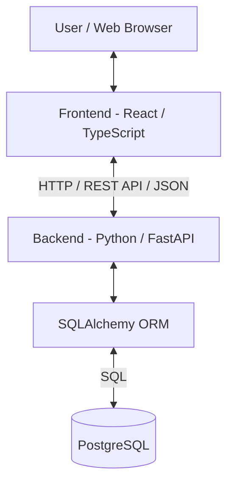

# Career Lab — System Architecture

## 1. 문서 정보

| 항목 | 내용 |
|---|---|
| 프로젝트명 | Career Lab |
| 문서명 | System Architecture |
| 문서 버전 | v0.1 |
| 작성일 | 2026.11.27 |
| 문서 상태 | Draft |

## 2. 시스템 설계 목적

Career Lab의 초기 MVP 구현을 위한
시스템 구성 요소 및 데이터 처리 구조를 정의한다.

프론트엔드, 백엔드, 데이터베이스의 역할을 분리하여
유지보수 및 기능 확장이 가능한 구조를 설계한다.

## 3. 전체 시스템 구성도

## 4. 구성 요소별 역할

### 4.1 Frontend

사용자가 플랫폼을 이용하기 위한 화면을 제공한다.

- 대시보드 화면
- 목표 및 학습 과제 관리
- 학습 노트 관리
- 자격증 관리
- Backend API 호출 및 응답 처리

### 4.2 Backend

사용자 요청을 처리하고 비즈니스 로직을 수행한다.

- REST API 제공
- 사용자 입력 데이터 검증
- 학습 목표 및 과제 관리
- 진행률 계산
- 데이터베이스 연동
- 오류 및 예외 처리

### 4.3 Database

플랫폼에서 관리하는 데이터를 영구적으로 저장한다.

- 목표 직무 정보
- 학습 목표 및 과제
- 학습 노트
- 자격증 정보
- 학습 상태 및 일정

### 4.4 ORM

Python 코드와 관계형 데이터베이스 간의
데이터 연동을 지원한다.

SQLAlchemy를 활용하여 데이터 모델과
데이터베이스 접근 로직을 관리한다.

## 5. 데이터 처리 흐름

학습 과제 등록을 예시로 한다.

1. 사용자가 화면에서 학습 과제 정보를 입력한다.
2. Frontend가 Backend에 HTTP POST 요청을 전송한다.
3. Backend가 요청 데이터를 검증한다.
4. SQLAlchemy를 통해 데이터베이스에 저장한다.
5. Backend가 처리 결과를 JSON 형태로 반환한다.
6. Frontend가 화면에 등록 결과를 표시한다.

## 6. 기술 스택 선정 이유

| 구분 | 기술 | 선정 이유 |
|---|---|---|
| Frontend | React | 컴포넌트 기반 UI 구현 |
| Language | TypeScript | 정적 타입 검사를 통한 오류 예방 |
| Build Tool | Vite | 프론트엔드 개발 및 빌드 환경 구성 |
| Backend | FastAPI | Python 기반 REST API 개발 |
| Database | PostgreSQL | 관계형 데이터 관리 및 확장성 |
| ORM | SQLAlchemy | Python 기반 데이터베이스 연동 |
| Migration | Alembic | 데이터베이스 스키마 변경 관리 |
| Testing | Pytest | 백엔드 기능 자동 검증 |

## 7. 초기 개발 환경

- 운영 환경: Local Development
- Frontend: localhost:5173
- Backend: localhost:8000
- Database: localhost:5432
- 형상 관리: Git / GitHub

포트 번호는 초기 설정안이며 개발 과정에서
필요에 따라 변경할 수 있다.

## 8. 향후 확장 계획

- Docker 기반 컨테이너 환경 구축
- LLM 기반 AI 학습 튜터 연동
- RAG 기반 기술 문서 검색
- AWS 기반 서비스 배포
- CI/CD 자동화
- 시스템 모니터링
- 독립적인 AI 모델 서빙
- 추론 성능 및 자원 사용량 최적화

## 9. 문서 변경 이력

| 버전 | 작성일 | 변경 내용 |
|---|---|---|
| v0.1 | 2026.11.27 | 초기 시스템 아키텍처 설계 |
